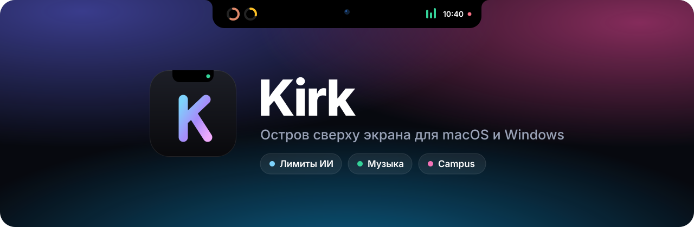
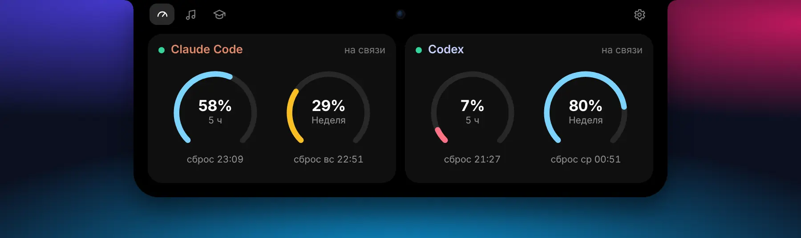
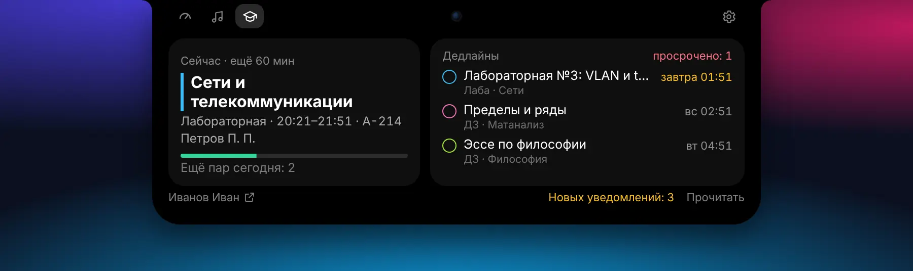
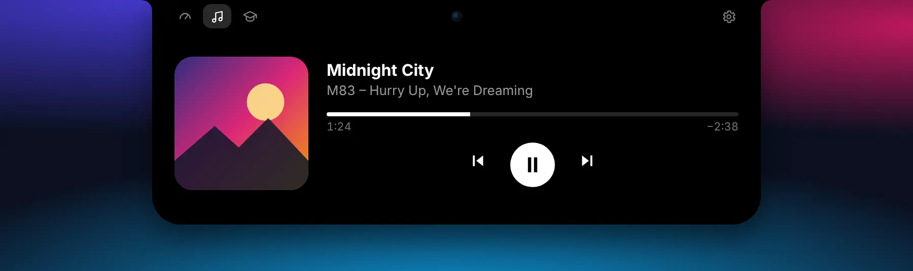
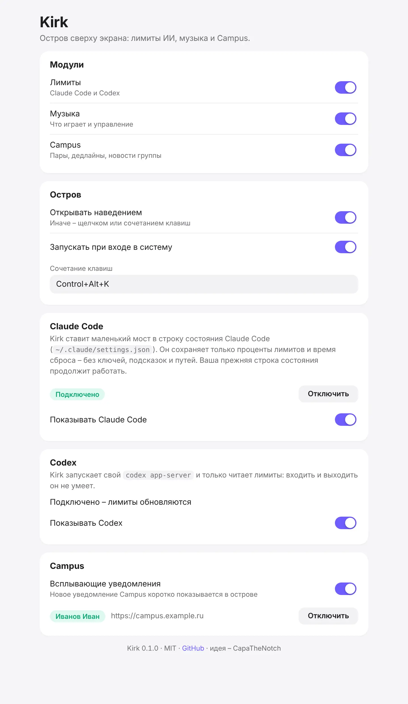
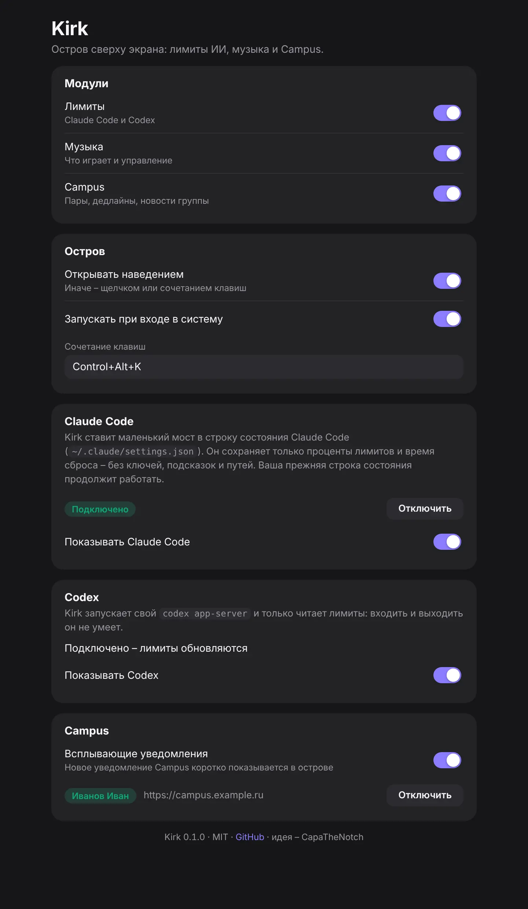
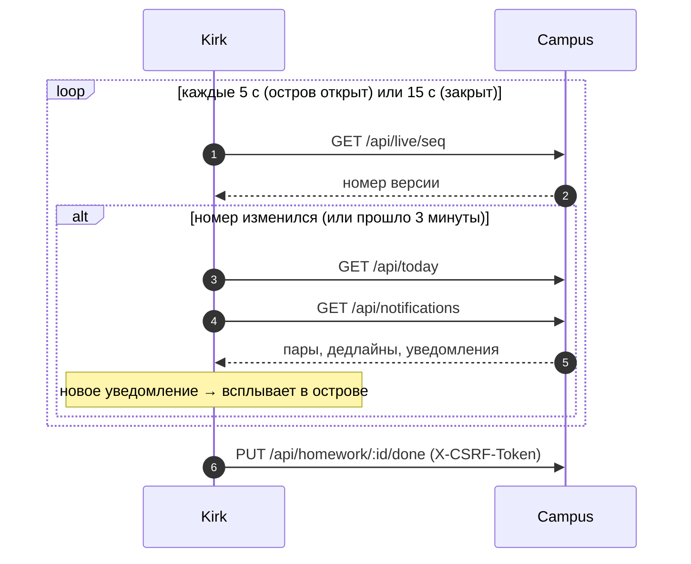
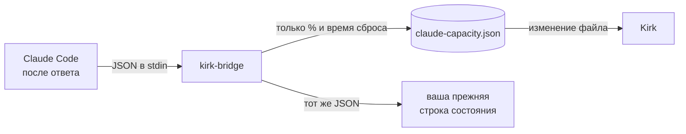
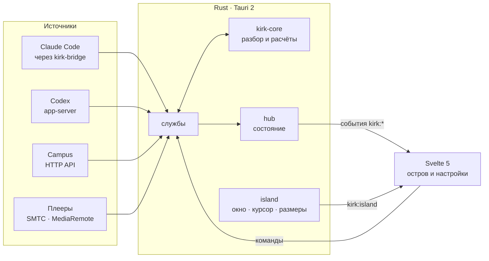

<div align="center">

<picture>
  <source media="(prefers-color-scheme: dark)" srcset="docs/banner-dark.svg" />
  <source media="(prefers-color-scheme: light)" srcset="docs/banner-light.svg" />
  
</picture>

<br />

[](https://github.com/mitaro-cs/Kirk/actions/workflows/ci.yml)
[](https://github.com/mitaro-cs/Kirk/releases)


[](LICENSE)

**[Возможности](#-возможности)** · **[Установка](#-установка)** · **[Campus](#-campus)** ·
**[Лимиты ИИ](#-лимиты-ии)** · **[Приватность](#-приватность-и-безопасность)** ·
**[Сборка](#-сборка-из-исходников)** · **[Вопросы](#-частые-вопросы)**

</div>

---

**Kirk** превращает верх экрана в живой остров. Закрытым он почти не занимает места: по бокам от
чёлки – остаток лимитов Claude Code и Codex, что играет и когда следующая пара. Наведите курсор – остров
плавно раскрывается: дуги лимитов со временем сброса, плеер, расписание и дедлайны группы из
**Campus**, которые можно отметить сделанными, не открывая браузер.

- **Одинаково на Mac и Windows.** На MacBook остров обнимает чёлку, на Windows и внешних мониторах –
  аккуратная «пилюля» по центру.
- **Не мешает работать.** Не забирает фокус, не перекрывает вкладки и кнопки под собой, в простое почти
  не тратит процессор.
- **Ничего лишнего наружу.** Учётные данные Claude Code и Codex Kirk не использует и не хранит; сессия
  Campus – в связке ключей системы.

<br />

## 📸 Как выглядит

<table>
  <tr>
    <td colspan="2" align="center">
      <br />
      <sub><b>Закрытый остров на MacBook.</b> Слева – остаток лимитов Claude Code и Codex, справа – обложка,
      эквалайзер и точка новых уведомлений Campus.</sub>
    </td>
  </tr>
  <tr>
    <td colspan="2" align="center">
      <br />
      <sub><b>Новое уведомление Campus</b> всплывает на 6 секунд; щелчок открывает его на сайте.</sub>
    </td>
  </tr>
  <tr>
    <td width="50%" align="center">
      <br />
      <sub><b>Лимиты.</b> Остаток окон «5 ч» и «Неделя», время сброса; цвет – темп расхода.</sub>
    </td>
    <td width="50%" align="center">
      <br />
      <sub><b>Campus.</b> Текущая пара с ходом времени, дедлайны с кружком «сделано».</sub>
    </td>
  </tr>
  <tr>
    <td width="50%" align="center">
      <br />
      <sub><b>Музыка.</b> Любой плеер на Windows; Music и Spotify на Mac.</sub>
    </td>
    <td width="50%" align="center">
      <br />
      <sub><b>Windows и мониторы без чёлки</b> – «пилюля» по центру с названием трека или пары.</sub>
    </td>
  </tr>
  <tr>
    <td width="50%" align="center">
      <br />
      <sub><b>Настройки</b> – светлая тема…</sub>
    </td>
    <td width="50%" align="center">
      <br />
      <sub>…и тёмная, по системе.</sub>
    </td>
  </tr>
</table>

<sub>Снимки – настоящий интерфейс Kirk на демо-данных.</sub>

<br />

## ✨ Возможности

<table>
<tr><th width="140">Модуль</th><th>Закрытый остров</th><th>Открытый остров</th></tr>
<tr>
  <td><b>⏱ Лимиты ИИ</b></td>
  <td>Кольцо остатка самого «узкого» окна Claude Code и Codex</td>
  <td>
    Дуги остатка для каждого окна (5 часов, неделя) и время сброса: «сброс 21:52», «сброс вс 21:35».<br />
    Цвет – <b>темп</b>: голубой – в норме, жёлтый – тратится быстрее времени, красный – меньше 10 %.
  </td>
</tr>
<tr>
  <td><b>🎵 Музыка</b></td>
  <td>Обложка и эквалайзер, пока играет</td>
  <td>Обложка, трек и исполнитель, позиция и остаток, пауза, следующий и предыдущий трек.</td>
</tr>
<tr>
  <td><b>🎓 Campus</b></td>
  <td>Время следующей пары или сколько осталось до конца текущей; красная точка – новые уведомления</td>
  <td>
    Текущая или следующая пара: вид, время, аудитория, преподаватель, полоска хода пары.<br />
    Дедлайны: кружок – <b>отметить сделанным</b>, название – открыть задание на сайте.<br />
    Счётчик уведомлений, «Прочитать», переход на сайт. Новые уведомления <b>всплывают</b> в острове.
  </td>
</tr>
</table>

**Поведение острова**

- **Открывается** наведением (через 0,15 с), щелчком или сочетанием <kbd>Control</kbd> <kbd>Alt</kbd> <kbd>K</kbd>
  (<kbd>⌃</kbd> <kbd>⌥</kbd> <kbd>K</kbd> на Mac; меняется в настройках).
- **Закрывается**, когда курсор ушёл на 0,4 с. Открытый сочетанием и нетронутый – сам через 8 с.
- **Не забирает фокус**: щёлкнули по острову – и печатаете дальше в своём окне.
- **Поверх всего**: над строкой меню и на всех рабочих столах; на Mac – и поверх полноэкранных приложений.
- **Значок в строке меню / области уведомлений**: открыть остров, настройки, выход. Автозапуск при входе в
  систему – переключателем.

<br />

## 🖥 Mac и Windows

| Что                               |                            macOS                            |                Windows                 |
| --------------------------------- | :---------------------------------------------------------: | :------------------------------------: |
| Остров вокруг чёлки               |                   ✅ на MacBook с чёлкой                    |             – (чёлки нет)              |
| «Пилюля» по центру                |             ✅ внешние мониторы, Mac без чёлки              |                   ✅                   |
| Не забирает фокус                 |                 ✅ `NSPanel`, nonactivating                 |         ✅ `WS_EX_NOACTIVATE`          |
| Нет в Dock / на панели задач      |                             ✅                              |                   ✅                   |
| Лимиты Claude Code и Codex        |                             ✅                              |                   ✅                   |
| Музыка – любой плеер              | ✅ с [mediaremote-adapter](#музыка-на-mac-из-любого-плеера) |       ✅ системные медиаэлементы       |
| Музыка – Music и Spotify          |                        ✅ из коробки                        |                   ✅                   |
| Обложка трека                     |                       ✅ с адаптером                        |                   ✅                   |
| Campus целиком                    |                             ✅                              |                   ✅                   |
| Сессия Campus в хранилище системы |                      ✅ Связка ключей                       |      ✅ Диспетчер учётных данных       |
| Установщик                        |               `.dmg` – Apple Silicon и Intel                | `.exe` (NSIS), без прав администратора |

<br />

## 📦 Установка

Скачайте последнюю версию со страницы **[Выпуски](https://github.com/mitaro-cs/Kirk/releases)**.

<details open>
<summary><b>🍏 macOS 13 Ventura и новее</b></summary>

1. Возьмите `.dmg` для своего Mac: **aarch64** – Apple Silicon (M1–M4), **x64** – Intel.
2. Перетащите **Kirk** в «Программы» и запустите.
3. Сборка пока без нотаризации Apple, поэтому при первом запуске macOS спросит, доверяете ли вы ей:
   **Системные настройки → Конфиденциальность и безопасность → «Всё равно открыть»**.
4. Остров появится вокруг чёлки, значок – в строке меню. В Dock Kirk не показывается.
5. При первой паузе в Music или Spotify macOS спросит, можно ли Kirk управлять плеером, – разрешите.

</details>

<details open>
<summary><b>🪟 Windows 10 и 11</b></summary>

1. Возьмите `Kirk_…_x64-setup.exe` и запустите – права администратора не нужны.
2. Сборка пока без подписи, поэтому SmartScreen может предупредить: **«Подробнее» → «Выполнить в любом случае»**.
3. Остров появится сверху по центру, значок – в области уведомлений.

</details>

### Первый запуск за минуту

1. **Значок Kirk → «Настройки…»**.
2. **Claude Code** – «Подключить». Лимиты придут после следующего ответа Claude Code.
3. **Codex** – ничего делать не нужно: если Codex установлен и выполнен `codex login`, лимиты появятся сами.
4. **Campus** – адрес сайта и 6 цифр из Campus (ниже – подробно).
5. Наведите курсор на остров. Готово.

<br />

## 🎓 Campus

Kirk – компаньон [Campus](https://github.com/mitaro-cs/Campus), сервиса учебной группы: расписание,
задания и уведомления без открытого браузера.

### Подключение

1. В Campus откройте **Профиль → Безопасность → «Показать код»**.
2. В Kirk: **Настройки → Campus** – адрес сайта (например, `campus.example.ru`) и 6 цифр.
3. Kirk войдёт как отдельное устройство – «Kirk · Mac» или «Kirk · Windows».

Сессия хранится в **связке ключей macOS** или **диспетчере учётных данных Windows**, не в файле. Выйти –
«Отключить» в настройках.

### Что умеет

| В острове                          | Как работает                                                                             |
| ---------------------------------- | ---------------------------------------------------------------------------------------- |
| Сейчас идёт / следующая пара       | из «Сегодня», пересчитывается по часам без запросов к сайту                              |
| Дедлайны и экзамены                | ближайшие невыполненные, по сроку; просроченные – счётчиком                              |
| ◯ Отметить сделанным               | задание сразу пропадает из списка, сайт подтверждает следом; при ошибке оно возвращается |
| Открыть задание, пару, уведомления | в браузере, только адреса своего сайта                                                   |
| Новые уведомления                  | счётчик, красная точка в закрытом острове и всплывание на 6 с                            |
| «Прочитать»                        | отмечает все уведомления прочитанными                                                    |

### Как Kirk узнаёт о новом

Kirk не перекачивает данные по таймеру. Раз в несколько секунд он спрашивает у Campus крошечный номер
версии (`/api/live/seq`) и перечитывает «Сегодня» и уведомления, только когда номер изменился. Ноутбук,
на котором работает сайт группы, лишней нагрузки не получает.



<details>
<summary><b>Какие адреса Campus использует Kirk</b></summary>

| Запрос                                                   | Зачем                                |
| -------------------------------------------------------- | ------------------------------------ |
| `GET /api/health`                                        | ключ CSRF перед входом и изменениями |
| `POST /api/auth/link/redeem`                             | вход по 6 цифрам                     |
| `GET /api/me`                                            | имя в настройках                     |
| `GET /api/live/seq`                                      | изменилось ли что-то на сайте        |
| `GET /api/today`                                         | пары, дедлайны, экзамены             |
| `GET /api/notifications`, `POST /api/notifications/read` | уведомления и «Прочитать»            |
| `PUT /api/homework/{id}/done`                            | отметка «сделано»                    |

Ответ считается ответом Campus, только если есть заголовок `X-Groupbase` или это JSON: страница туннеля
при выключенном компьютере хоста за данные не принимается.

</details>

<br />

## ⏱ Лимиты ИИ

### Claude Code

Claude Code после каждого ответа запускает команду **строки состояния** и передаёт ей JSON с лимитами.
Kirk ставит туда свой маленький мост:



- Мост сохраняет **только** проценты и время сброса окон «5 часов» и «Неделя» – без подсказок, путей,
  модели и ключей. Сессии различаются хешем id, сам id не хранится.
- Если строка состояния у вас уже была, она продолжит работать: мост передаёт ей тот же вход.
- Несколько открытых сессий не мешают друг другу: для каждого окна берётся та, где лимит менялся последним, –
  простаивающая сессия не затирает свежие цифры.
- Установка правит только ключ `statusLine` в `~/.claude/settings.json` и сохраняет копию
  `settings.json.kirk-backup`. «Отключить» возвращает прежнюю команду.

<details>
<summary>Что именно лежит в файле моста</summary>

```json
{
  "schema_version": 1,
  "captured_at": 1792178225.6,
  "windows": [
    { "id": "five_hour", "used_percentage": 42.0, "resets_at": 1792186425.0 },
    { "id": "seven_day", "used_percentage": 71.0, "resets_at": 1792358425.0 }
  ],
  "sessions": [{ "id": "043a718774c5", "seen_at": 1792178225.6, "windows": ["…"] }]
}
```

</details>

### Codex

Kirk запускает свой `codex app-server` и общается с ним по JSON-RPC. Отправлять он может только четыре
метода – `initialize`, `initialized`, `account/read`, `account/rateLimits/read` – и слушает
`account/rateLimits/updated`. Методов входа, выхода и токенов в списке нет: учётные данные Codex Kirk не
трогает. Лимиты обновляются при каждом уведомлении Codex и не реже раза в 5 минут.

Codex ищется в приложении ChatGPT, Homebrew, `~/.local/bin`, `%APPDATA%\npm` и в `PATH`.

<br />

## 🔒 Приватность и безопасность

| Данные             | Где хранятся                             | Уходят с компьютера?      |
| ------------------ | ---------------------------------------- | ------------------------- |
| Лимиты Claude Code | `claude-capacity.json` в каталоге Kirk   | нет                       |
| Лимиты Codex       | только в памяти                          | нет                       |
| Сессия Campus      | Связка ключей / диспетчер учётных данных | только на ваш сайт Campus |
| Настройки          | `config.json` в каталоге Kirk            | нет                       |
| Что играет         | только в памяти                          | нет                       |

- Каталог Kirk: macOS – `~/Library/Application Support/app.kirk/`, Windows – `%APPDATA%\app.kirk\`.
- Интерфейс работает под строгим CSP (`default-src 'self'`): никаких внешних шрифтов, картинок и
  скриптов.
- Ссылки на Campus открываются только на адреса своего сайта – уведомление не может увести на чужой.
- Без телеметрии и аналитики.

<br />

## ⚡ Производительность

- **Без опроса там, где можно ждать события.** Файл моста – через наблюдение за файловой системой,
  Windows-медиа – через системные события, Codex – через уведомления сервера.
- **Остров открывается по курсору.** Раз в 100 мс Kirk сверяет положение курсора с прямоугольником
  острова – одинаково на Mac и Windows.
- **Окно ровно по острову.** Прозрачное окно на весь верх экрана перехватывало бы щелчки по вкладкам
  браузера под ним; поэтому окно растёт и сжимается вместе с островом.
- **Тихий интерфейс.** Пока остров закрыт, часы тикают раз в 30 секунд; анимации – только CSS. Событие
  окну приходит, только если данные действительно изменились.
- **Нативное ядро.** Логика на Rust, интерфейс – Svelte 5 без тяжёлых библиотек.

<br />

## 🧩 Устройство



```
crates/kirk-core     лимиты, мост, JSON-RPC Codex, модели Campus, разбор музыки, геометрия – с тестами
crates/kirk-bridge   мост строки состояния Claude Code
src-tauri/           оболочка: окно-остров, трей, службы, код для Mac и Windows
src/                 интерфейс: island/ (остров и страницы), settings/, lib/
scripts/             подготовка моста и mediaremote-adapter перед сборкой
docs/                обложка и снимки README
```

<br />

## 🛠 Сборка из исходников

**Нужно:** Rust stable, Node.js 22+. На macOS – Xcode Command Line Tools, на Windows – Visual Studio Build
Tools (C++), на Linux – WebKitGTK 4.1 (список пакетов – в [`ci.yml`](.github/workflows/ci.yml)).

```sh
git clone https://github.com/mitaro-cs/Kirk && cd Kirk
npm ci
npm run tauri dev       # приложение из исходников с горячей перезагрузкой интерфейса
npm run tauri build     # установщик для этой системы → target/release/bundle/
```

Мост `kirk-bridge` собирается сам (`scripts/prepare.mjs`) и кладётся рядом с приложением.

| Команда                                                 | Что делает                                                  |
| ------------------------------------------------------- | ----------------------------------------------------------- |
| `cargo test --workspace`                                | тесты ядра (лимиты, мост, Codex, Campus, музыка, геометрия) |
| `cargo clippy --workspace --all-targets -- -D warnings` | строгая проверка Rust                                       |
| `cargo fmt --all --check`                               | форматирование Rust                                         |
| `npm run check`                                         | проверка типов Svelte и TypeScript                          |
| `npm run lint` / `npm run format`                       | Prettier                                                    |

### Музыка на Mac из любого плеера

Из коробки Kirk видит Music и Spotify через системные уведомления. Чтобы видеть любой плеер из «Пункта
управления» (браузеры, YouTube, Яндекс Музыку…) и обложки, положите исходники
[mediaremote-adapter](https://github.com/ungive/mediaremote-adapter) (BSD-3) в `vendor/mediaremote-adapter`,
например подмодулем. `scripts/prepare.mjs` сам соберёт `MediaRemoteAdapter.framework` и встроит его в
приложение.

### CI и выпуски

- Каждый пуш: проверки на Linux, затем установщики для **macOS Apple Silicon**, **macOS Intel** и
  **Windows** – они лежат в артефактах запуска.
- Тег `v*` (например, `v0.2.0`) – черновик выпуска со всеми установщиками; тег с дефисом (`v0.2.0-beta.1`) –
  предварительный выпуск.

<br />

## 🗺 Дорожная карта

- [x] Остров для Mac (чёлка) и Windows, лимиты Claude Code и Codex, музыка, Campus
- [x] Отметка «сделано», переходы на сайт, всплывание уведомлений Campus
- [ ] **Сеть**: пинг и джиттер, Wi-Fi, скорость, traceroute, DNS, калькулятор подсетей
- [ ] Полка для файлов с передачей между Mac и Windows по локальной сети
- [ ] Свои индикаторы громкости и яркости, заряд наушников
- [ ] Диктовка, суфлёр под камерой, перевод на устройстве, календарь
- [ ] Подпись приложений и автообновление

<br />

## ❓ Частые вопросы

<details>
<summary><b>Почему macOS пишет, что не может проверить разработчика?</b></summary>

Сборки пока без нотаризации Apple. Откройте **Системные настройки → Конфиденциальность и безопасность** и
нажмите **«Всё равно открыть»** – это нужно один раз.

</details>

<details>
<summary><b>Лимиты Claude Code не появляются</b></summary>

1. Проверьте, что в **Настройки → Claude Code** стоит «Подключено».
2. Лимиты приходят **после следующего ответа** Claude Code – отправьте любое сообщение.
3. Если вы задаёте `CLAUDE_CONFIG_DIR`, Kirk правит `settings.json` в этом каталоге.

</details>

<details>
<summary><b>Codex пишет «не найден» или «войдите»</b></summary>

Установите Codex и выполните `codex login` в терминале. Kirk проверяет снова раз в несколько минут или после
перезапуска.

</details>

<details>
<summary><b>Не работает сочетание клавиш</b></summary>

Скорее всего, его уже заняла другая программа. Задайте своё в **Настройки → Остров → Сочетание клавиш**,
например `Control+Shift+Space`.

</details>

<details>
<summary><b>Campus: «По этому адресу не Campus или сайт сейчас выключен»</b></summary>

Проверьте адрес и что компьютер, на котором работает сайт группы, включён. Код живёт 3 минуты и
срабатывает один раз – если он истёк, покажите новый.

</details>

<details>
<summary><b>Как полностью удалить Kirk?</b></summary>

1. **Настройки → Claude Code → «Отключить»** – вернёт прежнюю строку состояния.
2. **Настройки → Campus → «Отключить»** – удалит сессию из связки ключей.
3. Удалите приложение и каталог `app.kirk` (macOS – `~/Library/Application Support/`, Windows –
   `%APPDATA%`).

</details>

<br />

## 🙏 Благодарности

- [CapaTheNotch](https://github.com/maximfakel/capa-the-notch) (MIT) – идея лимитов ИИ в чёлке. Kirk написан
  с нуля и работает на Mac и Windows.
- [Tauri](https://tauri.app), [Svelte](https://svelte.dev), [tauri-nspanel](https://github.com/ahkohd/tauri-nspanel),
  [mediaremote-adapter](https://github.com/ungive/mediaremote-adapter).

## 📄 Лицензия

[MIT](LICENSE) © mitaro-cs
